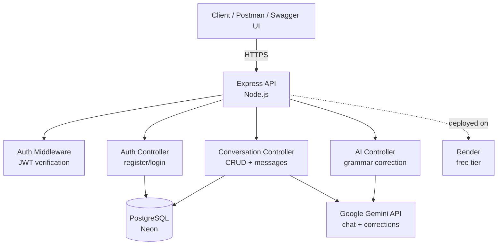

# Luma

An AI-powered language conversation practice app — backend API. Solo rebuild of a 
project originally built with a 7-person team, redone independently using raw SQL 
(no ORM), free-tier infrastructure, JWT auth, and an automated test suite, to 
deepen backend fundamentals.

**Live API**: https://luma-api-djcb.onrender.com  
**Live web app**: https://luma-web-livid.vercel.app  
**Swagger docs**: https://luma-api-djcb.onrender.com/api-docs  
**Health check**: https://luma-api-djcb.onrender.com/health

> Note: hosted on Render's free tier — the server spins down after 15 minutes of 
> inactivity. First request after idle may take 30–60 seconds to respond.

The frontend for this API lives in a separate repo: [Luma Web](https://github.com/parkjoshua0212/luma-web).

## Contents
- [What it does](#what-it-does)
- [Skills demonstrated](#skills-demonstrated)
- [Tech Stack](#tech-stack)
- [Architecture](#architecture)
- [Features](#features)
- [Testing](#testing)
- [API Overview](#api-overview)
- [Design decisions](#design-decisions)
- [Fixes & hardening](#fixes--hardening)
- [Running locally](#running-locally)
- [What's next](#whats-next)

---

## What it does
Users register, start a conversation session in **formal** or **casual** mode, and 
chat with an AI language partner (Gemini) that adapts its tone accordingly. As you chat, 
Luma checks your grammar in the background — a small lightbulb icon appears on any 
message with a mistake, and clicking it shows the correction and explanation inline, 
without leaving the conversation. A separate standalone endpoint also checks any 
sentence for grammar errors on its own.

## Skills demonstrated
- REST API design with Express, including auth middleware and route protection
- Raw SQL with parameterized queries (no ORM) — manual connection pooling and 
  data-ownership enforcement
- JWT authentication + bcrypt password hashing
- Rate limiting to mitigate brute-force/credential-stuffing attempts
- Automated testing with Jest + Supertest — unit tests, middleware tests, and 
  integration tests covering auth, conversation CRUD, and IDOR protection specifically
- Third-party API integration (Google Gemini) with structured JSON output parsing
- API documentation via Swagger/OpenAPI
- Deployment to a live environment (Render + Neon Postgres)
- Iterative hardening: found and fixed real bugs (see "Fixes & hardening" below) 
  after the initial build, rather than treating v1 as final

## Tech Stack
- **Backend**: Node.js, Express
- **Database**: PostgreSQL (raw SQL via `pg` — no ORM)
- **Auth**: JWT + bcrypt
- **AI**: Google Gemini API
- **Security**: Helmet, scoped CORS, rate limiting
- **Testing**: Jest, Supertest
- **Docs**: Swagger / OpenAPI
- **Hosting**: Render (API), Neon (Postgres)

## Architecture



## Features
- User registration & login (JWT-based auth)
- Auth middleware protecting all user-specific routes
- Rate limiting on login/register to slow brute-force attempts
- Security headers via Helmet, CORS restricted to an explicit origin allowlist
- Prompt injection mitigation on AI-facing endpoints (system instructions kept
  structurally separate from user input, plus input length caps)
- Conversation sessions (start, list, get, delete)
- AI chat with formal/casual tone modes, with conversation history context
- Inline grammar correction during chat — messages with errors show a lightbulb
  icon with the correction and explanation, without interrupting the conversation
- Grammar correction with structured JSON output + explanation (standalone endpoint)
- Interactive Swagger API docs
- Health check endpoint (verifies DB connectivity)
- Automated test suite (unit + integration)
- Deployed and live

---

## Testing

The project has an automated test suite using **Jest** (test runner) and 
**Supertest** (HTTP assertions against the Express app). Tests run against 
mocked dependencies (database, JWT verification) — no real database or 
external API calls happen during test runs.

**Run the tests:**
```bash
npm install
npm test
```

**Current coverage:**
| File | Type | What it verifies |
|---|---|---|
| `tests/validators.test.js` | Unit | Password length rule, conversation mode validation |
| `tests/authMiddleware.test.js` | Unit | JWT middleware correctly accepts valid tokens and rejects missing/malformed/invalid ones |
| `tests/health.test.js` | Integration | `/health` returns the correct status for both a healthy and an unreachable database |
| `tests/auth.test.js` | Integration | Register validation (missing fields, short password, duplicate email) and successful registration; login rejects unknown users and wrong passwords (using real bcrypt comparison, not mocked) and succeeds with correct credentials |
| `tests/conversations.test.js` | Integration | All conversation routes require auth; mode validation on starting a conversation; list/get/delete all behave correctly; **explicitly verifies IDOR protection** — confirms the ownership check query is actually filtered by the token's decoded user ID |

36 tests total, all passing.

> **Honest scope note**: auth (register/login) and conversation CRUD are now covered, 
> including the IDOR protection specifically. Not yet covered: the Gemini-dependent 
> code paths (`sendMessage`'s AI reply/grammar-check flow, the retry/quota logic) — 
> these need heavier mocking around external API calls and are the next tests planned.

---

## API Overview

### Auth
| Method | Endpoint | Description | Auth |
|---|---|---|---|
| POST | /api/auth/register | Create new user | No |
| POST | /api/auth/login | Login, returns JWT | No |
| GET | /api/auth/me | Get current user | Yes |

### Conversations
| Method | Endpoint | Description | Auth |
|---|---|---|---|
| POST | /api/conversations/start | Start a new conversation | Yes |
| GET | /api/conversations | List user's conversations | Yes |
| GET | /api/conversations/:id | Get conversation + messages | Yes |
| DELETE | /api/conversations/:id | Delete a conversation | Yes |
| POST | /api/conversations/:id/message | Send message, get AI reply | Yes |

### AI
| Method | Endpoint | Description | Auth |
|---|---|---|---|
| POST | /api/ai/correct | Grammar correction + explanation | Yes |

Full interactive docs: `/api-docs`

---

## Design decisions
- **Raw SQL over an ORM**: chose `pg` instead of Prisma (used in the original team 
  project) specifically to understand what an ORM abstracts — connection pooling, 
  parameterized queries, manual relation handling.
- **IDOR protection**: every conversation query filters by both `id` and `user_id`, 
  since raw SQL doesn't enforce data ownership automatically the way some ORMs' 
  relation helpers do.
- **Structured AI output**: the grammar correction endpoint prompts Gemini to return 
  JSON directly, then strips markdown code fences the model sometimes wraps around it.
- **Conversation-scoped tone**: mode (formal/casual) is set once at conversation start 
  and drives the system prompt for every message in that session, plus prior messages 
  are passed back into each Gemini call for context continuity.
- **`app.js` / `index.js` split**: the Express app is defined in `app.js` and exported, 
  while `index.js` just imports it and calls `.listen()`. This lets tests import the 
  app directly with Supertest without starting a real server on a port.
- **Parallel Gemini calls for inline grammar correction**: sending a chat message 
  triggers the conversational reply and a grammar check at the same time 
  (`Promise.allSettled`), rather than one combined prompt asking Gemini to return 
  both. Simpler to reason about and test independently, at the cost of doubling 
  Gemini API usage per message — a deliberate trade-off given the free-tier daily 
  quota, documented in "Fixes & hardening" below.

## Fixes & hardening
This project went through five rounds of post-launch review and real-world testing — 
each one found genuine issues (not hypothetical ones) and fixed them: an orphaned-data 
bug, missing password/rate-limit protection, wide-open CORS, a prompt injection gap, 
a bug in the grammar-correction feature caught during manual testing, Gemini failure 
handling, and two deployment-specific bugs. 

**Full details, with the reasoning behind each fix: [CHANGELOG.md](./CHANGELOG.md)**

## Running locally

1. Clone the repo
2. `npm install`
3. Copy `.env.example` to `.env` and fill in your own values (Postgres URL, JWT 
   secret, Gemini API key)
4. Run `db/schema.sql` against your Postgres instance (or, if upgrading an existing 
   database, run the files in `db/migrations/` instead)
5. `npm run dev`
6. Visit `http://localhost:3000/api-docs`
7. Run `npm test` to run the automated test suite

## What's next
- React Native mobile frontend reusing this same API
- CI (GitHub Actions) to run tests automatically on push
- Test coverage for the Gemini-dependent code paths (chat reply, grammar check, retry/quota logic)

## License
MIT — see [LICENSE](./LICENSE)